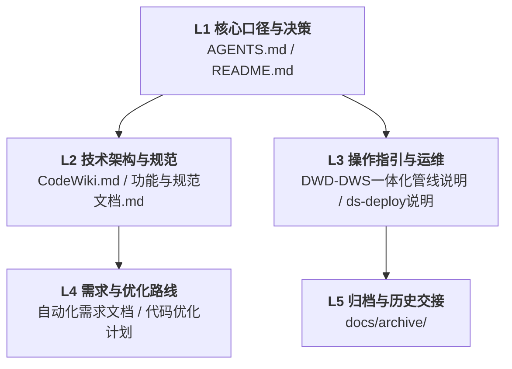

# 数仓代码生成项目 — 文档导航全景

本文档为项目文档的总目录索引，梳理了仓库内各文档的层级、定位与适用场景。

---

## 📚 文档分级索引

### L1 · 核心口径与决策（唯一权威源）
> **原则**：只记决策、判定规则与为什么这么做；不记当次执行的临时数字、实例号或条数。

- [AGENTS.md](../AGENTS.md) — **项目核心业务与技术口径全文**。包含数仓命名、MASTER 主数据保护、DWD 工作流归属、T-1 免配依赖、DWS 修复基线及重启顺序。
- [README.md](../README.md) — 仓库顶层说明与常见操作快捷入口（WSL 运行、常用生成与校验命令）。
- [CLAUDE.md](../CLAUDE.md) — AI 助手短入口，唯一指向 `AGENTS.md`。

---

### L2 · 技术架构与规范标准
> 详细描述代码工程组织方式与底层生成标准。

- [CodeWiki.md](CodeWiki.md) — **代码库架构全貌**。模块拆解、数据流（IR 中间表示）、核心类/函数说明与依赖拓扑。
- [功能与规范文档.md](功能与规范文档.md) — **生成工具功能与技术规范**。详细记录各层级（ODS/DWD/DWS）调研表格式规范、类型映射、系统字段与 Hive 4.2 方言清洗规则。

---

### L3 · 操作指引与运维维护
> 面向开发与跑批操作人员的实操手册。

- [DWD-DWS一体化管线使用说明.md](DWD-DWS一体化管线使用说明.md) — 一体化管线 `tools/dw-pipeline.py` 实操指南（脚本搬移、比对、DDL 对账与校验）。
- [tools/ds-deploy/README.md](../tools/ds-deploy/README.md) — DolphinScheduler 部署工具链、安全护栏、依赖编排与 SQL 语法编译校验手册。
- [DWD-ODS依赖体检报告.md](DWD-ODS依赖体检报告.md) — 依赖体检说明与前一日（T-1）免配规则。

---

### L4 · 需求基线与优化路线
> 记录系统演进需求与重构计划。

- [自动化生成需求文档.md](自动化生成需求文档.md) — 统一端到端自动化生成管线的需求基准与验收条件。
- [代码优化实施计划.md](代码优化实施计划.md) — 阶段性代码质量优化、架构拆分、异常收窄与缓存治理路线图。

---

### L5 · 历史与阶段性归档
> 存放已定稿、不再更新的历史试验或阶段性交接文件，仅作背景留档。

- [archive/主数据生成说明.md](archive/主数据生成说明.md) — 2026-10-04 主数据 DWD 生成可行性试验记录（当前生产已按甲方交付直接纳管，禁止生成器覆盖）。
- [archive/DWD-PTY-NUM-MAPP-修复交接.md](archive/DWD-PTY-NUM-MAPP-修复交接.md) — 历史编号映射修复交接记录。

---

## 🤖 工作区自定义技能（`.agents/skills/`）

供 AI 助手按需激活的 5 个专项规程（由 `tools/tests/test_skills_integrity.py` 守护结构与路径完整性）：

| 技能 | 路径 | 职责边界 |
|------|------|----------|
| `dw-field-translate` | [../.agents/skills/dw-field-translate/SKILL.md](../.agents/skills/dw-field-translate/SKILL.md) | 按信达澳亚词根库将中文字段名译为英文缩写（内含 `translate.py` 与词根快照） |
| `dw-generate` | [../.agents/skills/dw-generate/SKILL.md](../.agents/skills/dw-generate/SKILL.md) | 从调研表或 MAPPING 生成 ODS/DWD/DWS（守住 MASTER 禁生成护栏，区分 `main.py` 直接写盘与 `dw-pipeline` dry-run） |
| `dw-sync` | [../.agents/skills/dw-sync/SKILL.md](../.agents/skills/dw-sync/SKILL.md) | 甲方脚本/DDL 搬移对账、`verify-ddl`、DDL 差异登记豁免、`repair` 拼接副本修复 |
| `dw-schedule` | [../.agents/skills/dw-schedule/SKILL.md](../.agents/skills/dw-schedule/SKILL.md) | 血缘梳理、依赖配置、DS 跑批预检（`ds-inspect.py running`）、工作流部署/排版/脚本同步 |
| `dw-code` | [../.agents/skills/dw-code/SKILL.md](../.agents/skills/dw-code/SKILL.md) | 修改 `tools/` Python 代码时的安全护栏与回归门禁 |
